# Bin Bin: User Guide

## Introduction

**Bin Bin** is a mobile app that tells you exactly how to dispose of any item,
based on the rules for your specific council, and rewards you for getting it
right with Bin Bin, a virtual pet you feed by sorting correctly.

This guide covers the minimum path to get value from the app: creating an
account, finding your council, identifying an item, and following its
disposal instructions. It doesn't cover every feature, just enough to get a
new user from install to "I know which bin this goes in."

---

## Step 1: Create an account

Open the app. On first launch you'll land on the sign-in screen.

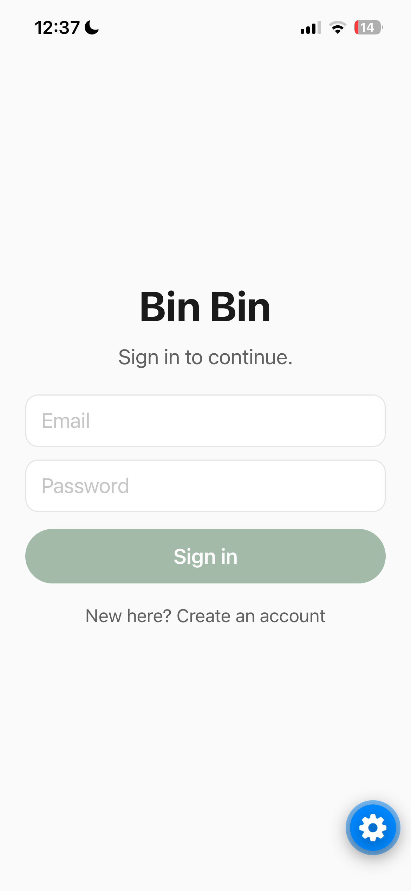

If you already have an account, enter your email and password and tap
**Sign in**.

Otherwise, tap **"New here? Create an account"**, enter an email and
password (a display name is optional), then tap **Create account**. You'll
be signed in automatically and taken straight to the Home tab.

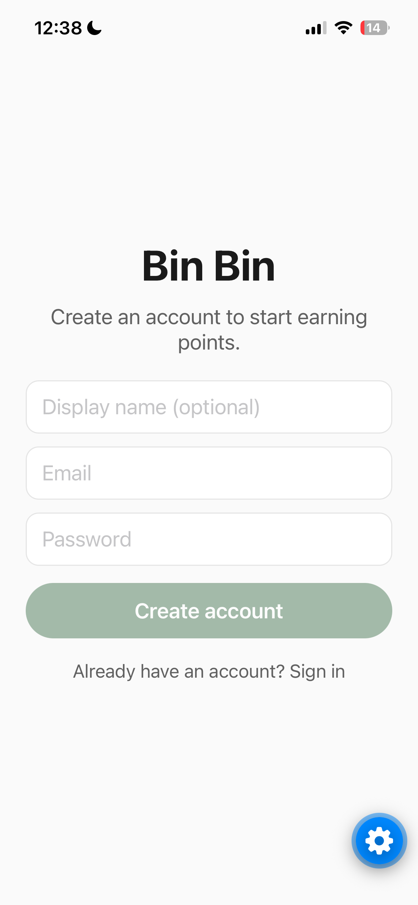

---

## Step 2: Check you're in the right council

On the **Map** tab (your home screen), you'll see a chip near the top showing
your current council, here **City of Sydney**. This is what every disposal
rule you see from here on is based on, along with your points balance and
sorting streak.

Tap the chip at any time to search for and switch to a different council.

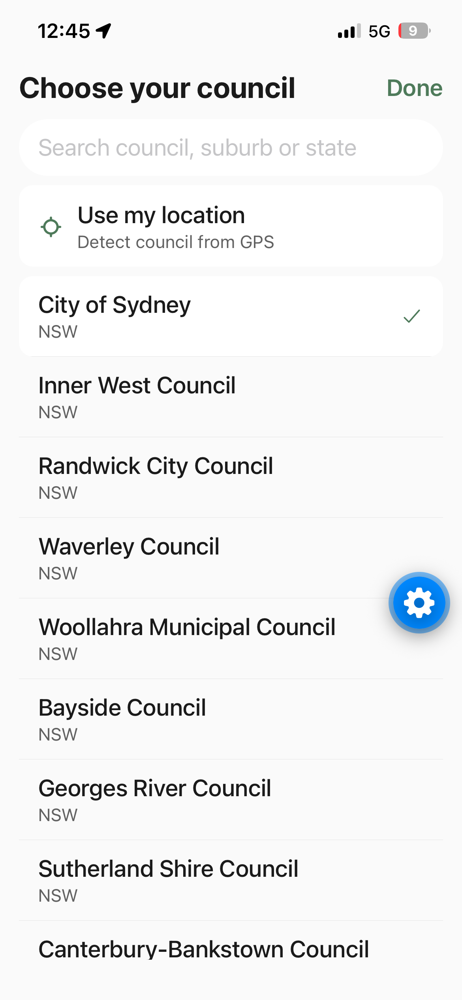

---

## Step 3: Scan an item

Tap the camera button in the middle of the bottom tab bar to open the
scanner, and point it at the item (or its barcode/label).

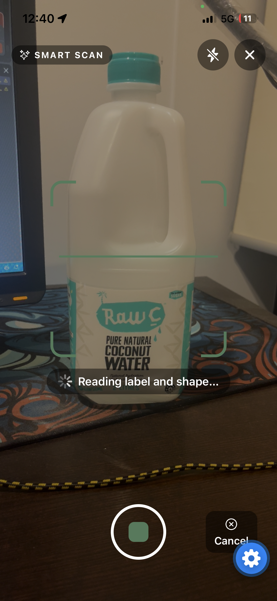

Bin Bin identifies it and shows your confidence level before looking up the
rule. Here's what that looks like for two very different kinds of item:

**An easy, everyday item**, identified instantly from its barcode:

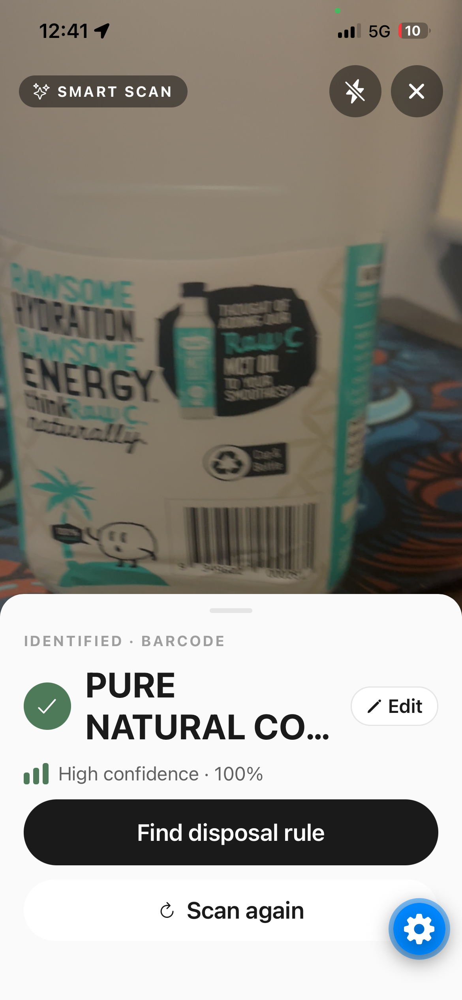

**A harder item with no obvious bin**, identified by photo match instead:

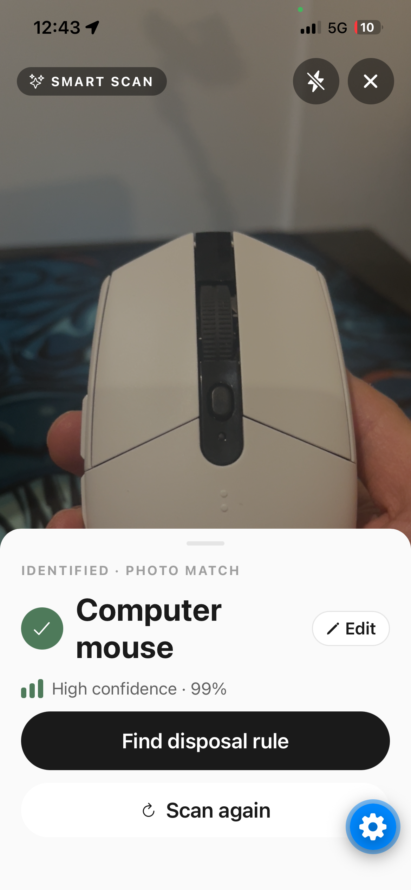

If Bin Bin can't identify something, you can always type the item's name in
manually instead.

---

## Step 4: Follow the disposal instructions

Tap **"Find disposal rule"** and you'll land on the **"How to Recycle It
Here"** screen. This is where Bin Bin earns its keep: the easy stuff gets a
quick confirmation, and the stuff nobody actually knows gets routed properly.

**The carton** is a simple kerbside case, straight into the yellow bin, with
a couple of quick prep steps:

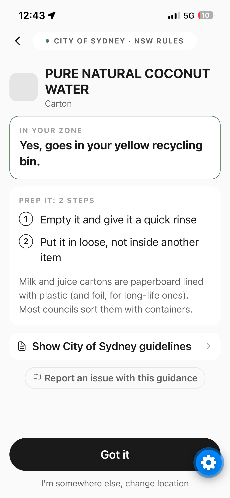

**The computer mouse** is e-waste, not accepted in any kerbside bin at all.
Bin Bin tells you that up front, shows prep steps, and finds the nearest
real drop-off point for your council:

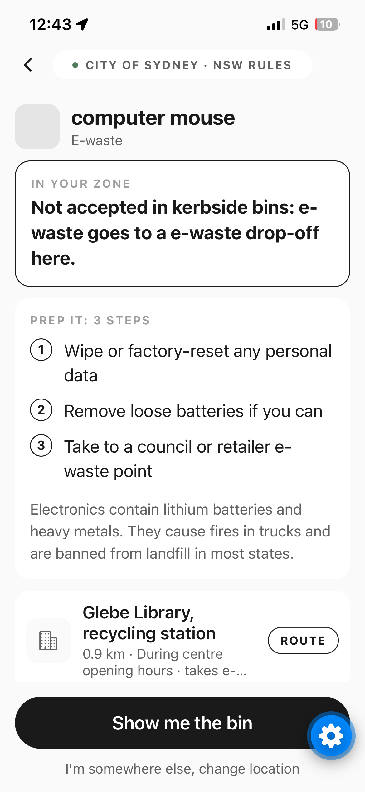

Read the steps, sort the item for real, then tap **"Got it"** (or, for a
drop-off item, **"Show me the bin"**) to confirm.

For a drop-off item, tapping **"Show me the bin"** (or the **ROUTE** pill
next to the nearest drop-off) opens Bin Bin's own in-app walking directions:
a next-turn card, live ETA and distance, and the full step list.

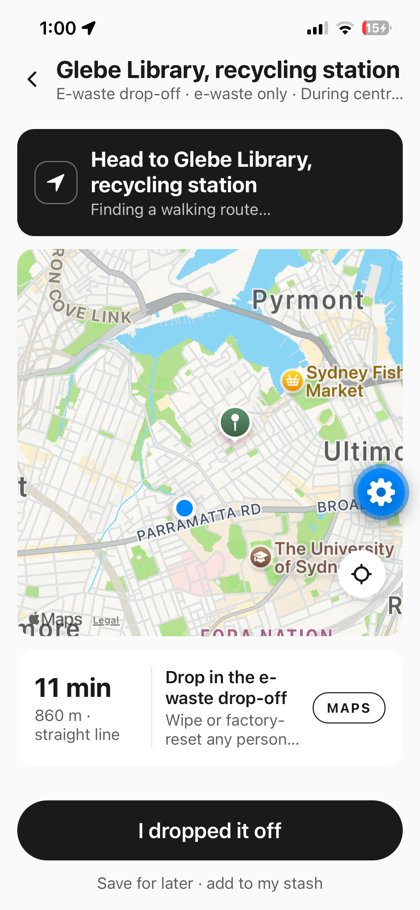

From there, tap **MAPS** if you'd rather hand off to your phone's own Maps
app for full navigation. Once you've dropped the item off, tap **"I dropped
it off"** to confirm and collect your points.

Not heading there right now? Tap **"Save for later · add to my stash"**
instead. The item goes into your stash, with no points yet.

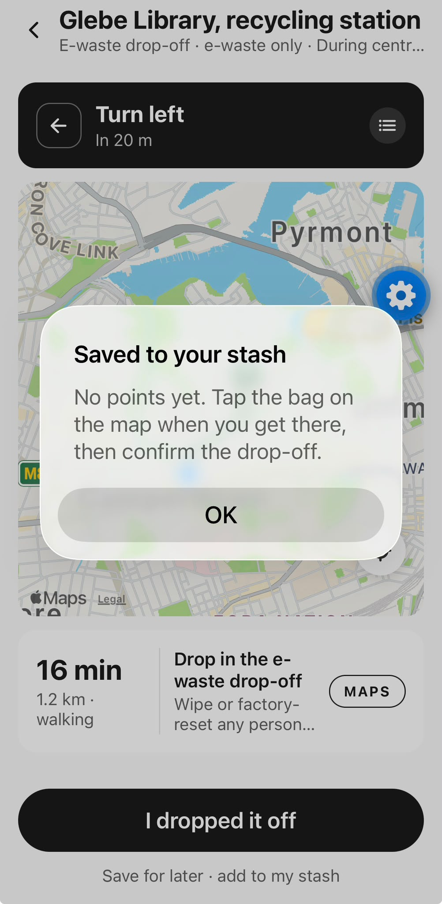

The bag on the Map tab, just above the locate button, now shows a count.
Tap it to open **Saved for later**, which lists everything you've saved with
its council and the date. Tap an item to reopen its route, or tap **✕** to
remove it.

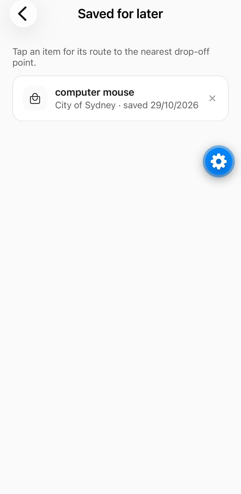

When you get to the drop-off, tap **"I dropped it off"** on the route screen,
then **"Yes, I dropped it off"**. That's when you get the points, and the
item leaves your stash.

---

## Step 5: Watch your pet get fed

Confirming a kerbside item earns you points and feeds **Bin Bin**, your
virtual pet, with that item's material.

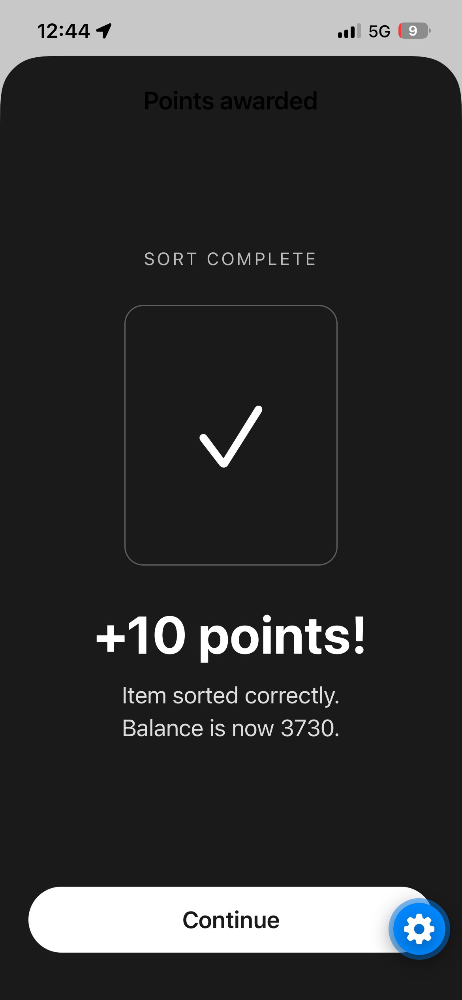

Check in on your pet any time from the **Pet** tab. Keep sorting correctly
and Bin Bin levels up and unlocks new skins per material:

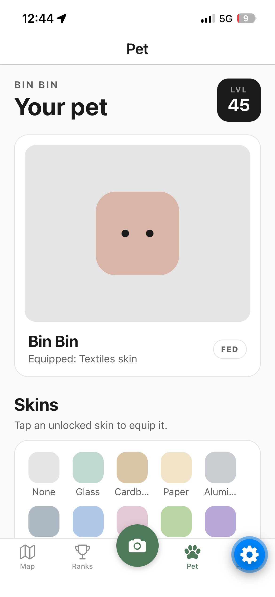

Scroll down on the Pet tab to see **Bin Bin's diet**: a meter per material
showing exactly how much of each you've fed it:

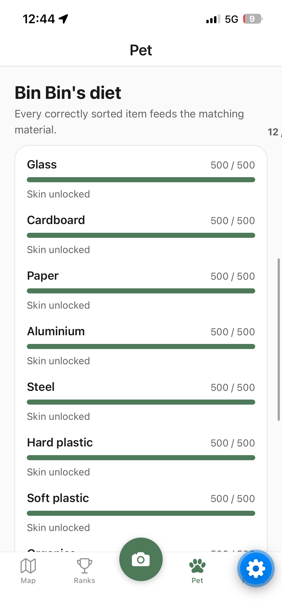

---

## That's it

At this point you've done everything Bin Bin exists for: scanned or typed an
item, found out exactly where it goes for your council (even the hard
cases), and fed your pet by doing it right.

From here, explore the **Ranks** tab for your local leaderboard:

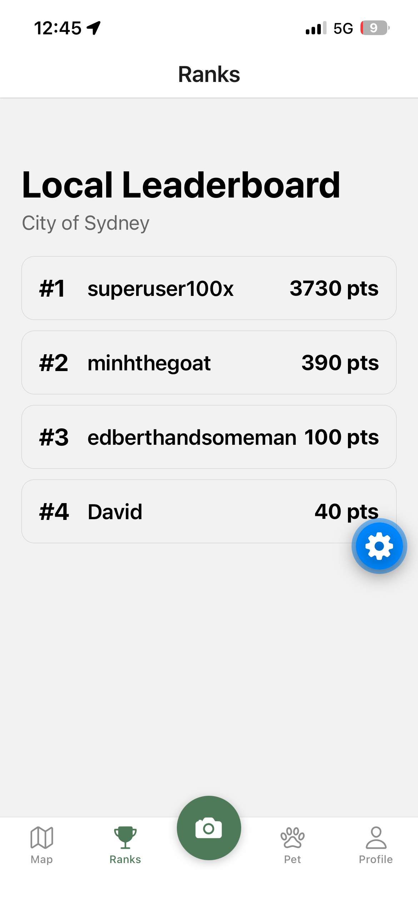

and your **Profile** tab for your **"week in trash"** recap:

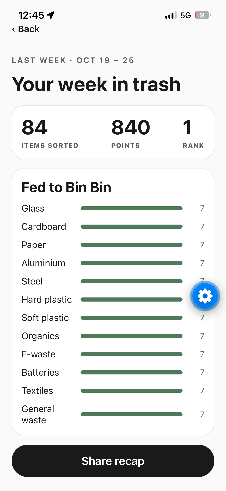

